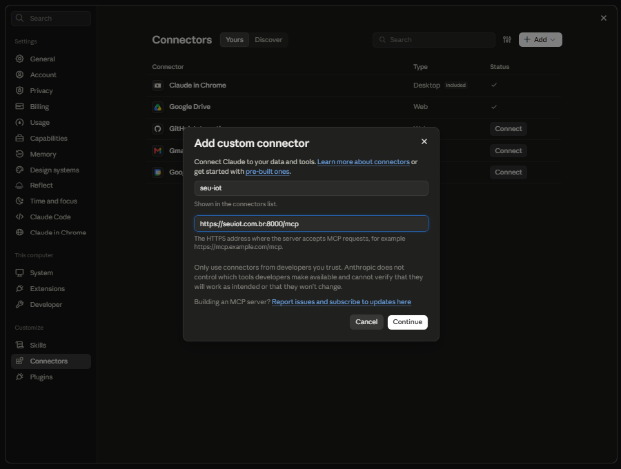
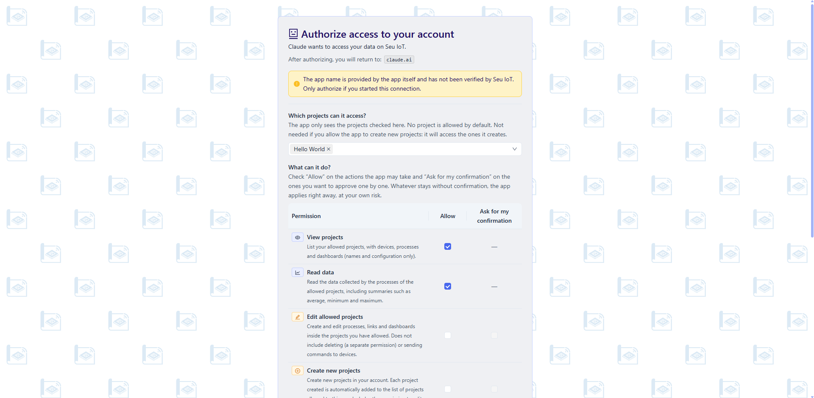
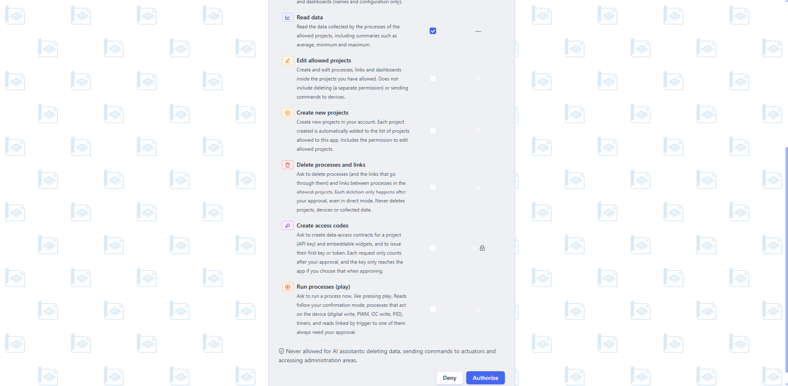

# Connect an AI assistant (MCP)

AI assistants such as Claude, Cursor or Gemini CLI can work with your Seu IoT account through **MCP** (Model Context Protocol). The assistant is just one more interface to your account: it only sees the projects you release, only does what you allow, and anything sensitive waits for your approval in the dashboard.

This is different from [API contracts](getting-started.md). A contract lets an *external system* read data with an API key. MCP lets an *AI assistant* work inside your account (list projects, read data, create processes and charts, even ask for a contract). An assistant can also create contracts for you, with your approval.

## Nothing to enable

There is no switch to turn on. The connection exists only when you **authorize an app**, and you can revoke it at any time. Until you authorize one, no assistant has access to anything.

## Connection URL

```
https://seuiot.com.br:8000/mcp
```

You do not paste any key: the assistant discovers how to sign in by itself (OAuth 2.1 with PKCE) and opens a Seu IoT page where **you** decide what it can access.

## Connect your assistant

| Client | How |
|---|---|
| **Claude Code** | `claude mcp add --transport http seu-iot https://seuiot.com.br:8000/mcp`, then run `/mcp` and authorize in the browser |
| **Claude.ai** | Settings > Connectors > add a custom connector with the URL above |
| **Gemini CLI** | In `settings.json`: `"mcpServers": { "seu-iot": { "httpUrl": "https://seuiot.com.br:8000/mcp" } }` |
| **Cursor** | In `mcp.json`: `"seu-iot": { "url": "https://seuiot.com.br:8000/mcp" }` |
| **ChatGPT** | MCP connectors, where your account has the feature. Custom GPT Actions are **not supported yet** |

Support for MCP connectors changes quickly between vendors, so check your client's current documentation. Any client that supports MCP over HTTP with OAuth should work.



## Authorize the app

When the assistant connects, your browser opens a Seu IoT page. If you are not signed in, sign in first. Then:

1. Check the app name. It is informed by the app itself and **was not verified by Seu IoT**: authorize only if you started this connection.
2. Choose **which projects** the app can access. No project is released by default. You do not need to release any if you let the app create new projects (it can then access the ones it creates).
3. In the permissions table, choose **what it can do** (see below). Start with the minimum: you can change it later.
4. Click **Authorize**, or **Deny** to share nothing.



## Permissions

| Permission | The app can |
|---|---|
| **View projects** | List your released projects with devices, processes and dashboards (names and configuration only) |
| **Read data** | Read the data collected by the processes, including summaries such as average, minimum and maximum |
| **Edit allowed projects** | Create and edit processes, links and charts inside the released projects. Does not include deleting, nor sending commands to devices |
| **Create new projects** | Create new projects in your account. Each one is released to the app automatically. Includes editing allowed projects |
| **Delete processes and links** | *Ask* to delete processes and links. Every deletion still waits for your approval |
| **Create access codes** | *Ask* to create data-access contracts (API key) and widgets, and to issue their first key or token. Always needs your approval |
| **Run processes (play)** | *Ask* to run a process now, like the play button |

Each permission has two boxes:

- **Allow**: the app may do this.
- **Ask for my confirmation**: each use waits for your approval. If you leave it unchecked, the app applies the action immediately, at your own risk.

A new connection starts with confirmation checked everywhere. Reading changes nothing, so it has no confirmation. For **Create access codes**, confirmation is always required.



**Never allowed to any AI assistant**: deleting projects or devices, deleting collected data, sending commands directly to actuators outside a process, rotating keys, billing and administration areas.

## Next steps

- [Manage connected apps](mcp-manage.md): approve changes, edit permissions, see what the app did and revoke access.
