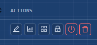
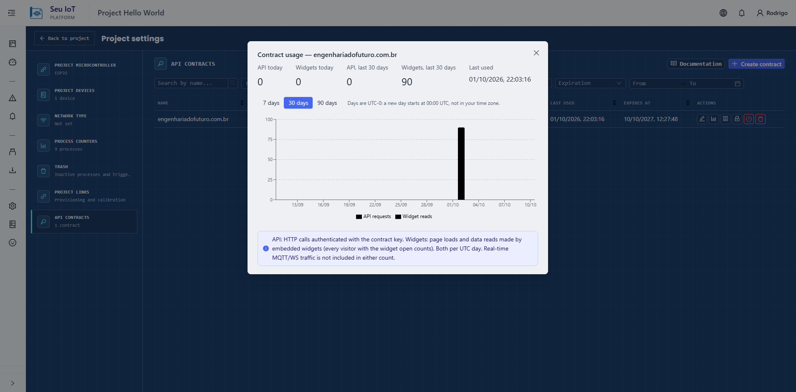

# Ciclo de vida: expiración, rotación, revocación y uso

## Expiración

La clave de API, y el login MQTT que viene con ella, valen **365 días**. Después, la REST responde `401` y el MQTT rechaza la conexión. Emite una clave nueva en el panel. El `embed_token` de un widget también dura 365 días.

## Rotación

La rotación se hace en el panel. Regenera la clave de API **y** el login MQTT juntos. Los anteriores dejan de funcionar al instante, sin período de solapamiento, así que actualiza los secretos de tu consumidor justo después.

Llamar a `POST /external/v1/mqtt-credentials` (o al `/bootstrap` público de un widget) también rota la contraseña MQTT. Evítalo en código en ejecución.

## Revocación

- **Revocar** un contrato: la REST responde `401` de inmediato, el login MQTT se deshabilita, los consumidores conectados reciben un mensaje en `/broker/api-contract/<contract_uuid>/revoked` y se desconectan, y los widgets del contrato se apagan.
- **Reactivar** devuelve la **misma** clave y el mismo login MQTT. Los widgets siguen apagados hasta que el dueño reactive cada uno.
- **Eliminar** un contrato lo envía a la papelera: deja de funcionar de inmediato y se purga después.
- Un consumidor que recibe el mensaje de revocación debe detenerse y **no** reintentar.

## Cambios de alcance

Editar los procesos y dispositivos del contrato se hace en el panel. Quitar elementos vale desde la próxima llamada REST y desconecta a los consumidores MQTT en vivo, que se reconectan con la lista de tópicos más corta.

## Seguir el uso

El panel muestra, por contrato, las solicitudes REST de hoy y de los últimos 30 días, y las cargas de widget, con una serie diaria. El MQTT no se cuenta.

Si el número de la REST sigue creciendo cuando esperabas actualizaciones en vivo, algún consumidor está haciendo polling: reemplázalo por una suscripción [MQTT](realtime-mqtt.md).

## Límites de un contrato

- Pertenece a **un proyecto**. Para dos proyectos, crea dos contratos.
- Nombre: hasta 100 caracteres.
- Alcance: de 1 a 50 procesos y hasta 50 dispositivos. Cualquier dispositivo listado puede leerse para cualquier proceso listado. Sin dispositivos listados, entran todos los del proyecto, incluso los añadidos después.
