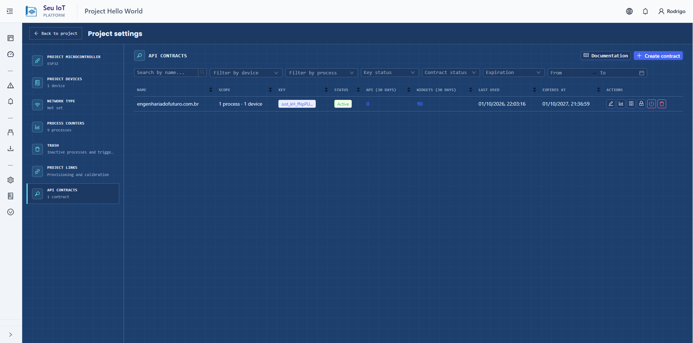
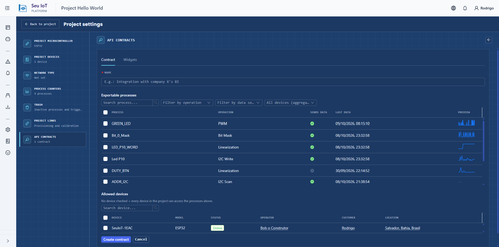
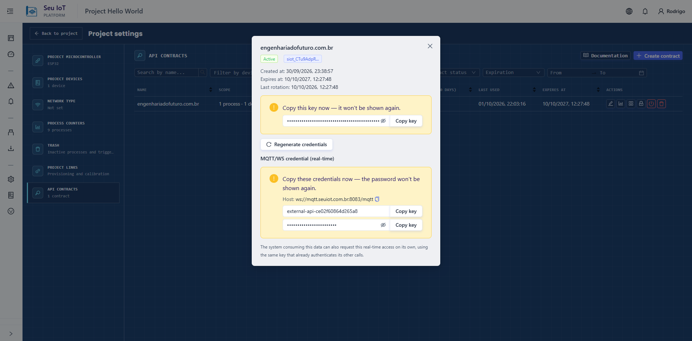

# Primeiros passos

1. No painel do Seu IoT, abra **Configurações do projeto > Contratos de API**.
2. Crie um contrato: dê um nome e escolha os **processos** e **dispositivos** que ele pode acessar. Uma lista de dispositivos vazia significa todos os dispositivos do projeto.
3. Emita a **chave de API** e copie-a imediatamente, incluindo o prefixo `siot_`. Trate-a como uma senha.
4. Teste se funciona:

```bash
curl -H "Authorization: Bearer siot_sua_chave" https://seuiot.com.br:8000/external/v1/contract
```

Um JSON descrevendo seu contrato indica que está tudo pronto. A partir daqui:

- dados históricos: [API REST](rest-api.md)
- dados ao vivo: [Tempo real (MQTT)](realtime-mqtt.md)
- um gráfico no seu site: [Widgets](widgets.md)

Editar o escopo do contrato no painel vale a partir da próxima requisição. Remover itens também desconecta os consumidores MQTT ao vivo, que reconectam com a lista de tópicos menor. Para receber itens recém-adicionados por MQTT, peça uma nova credencial.

## Guia visual






