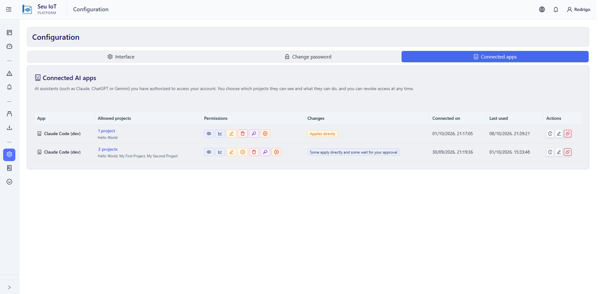
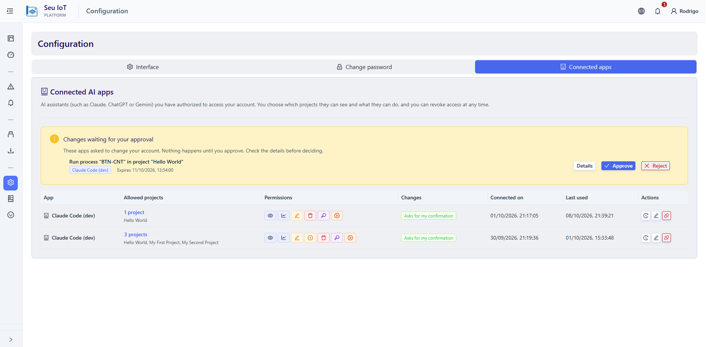
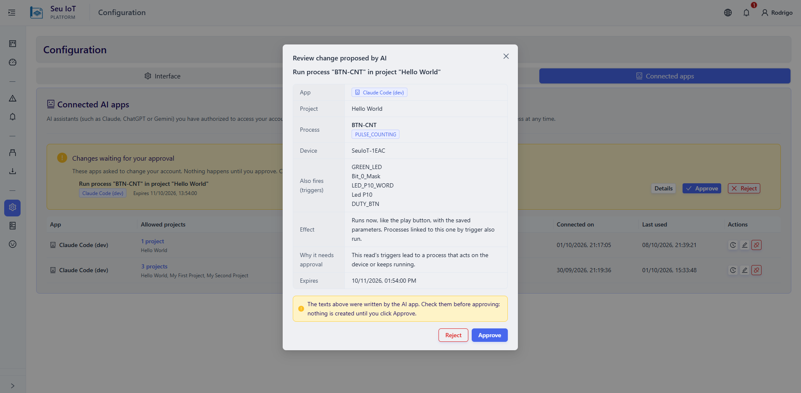
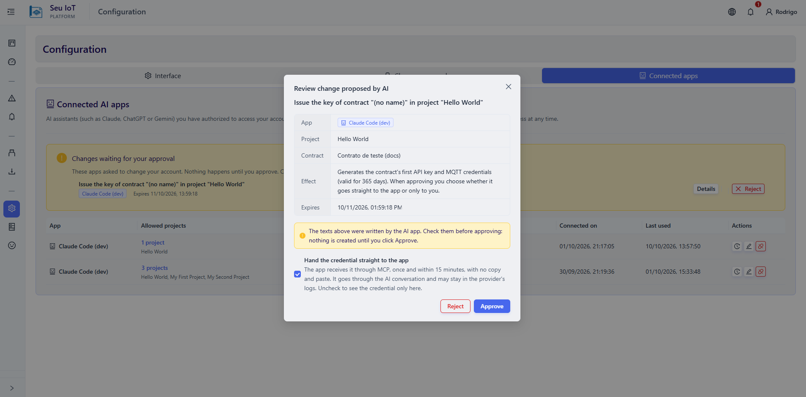
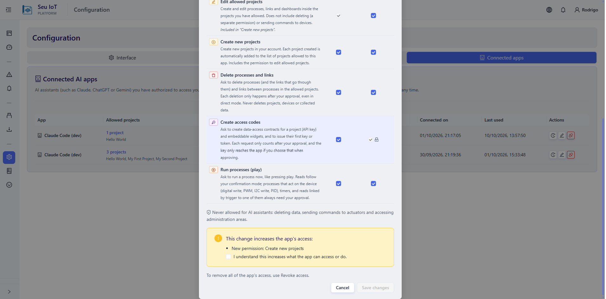
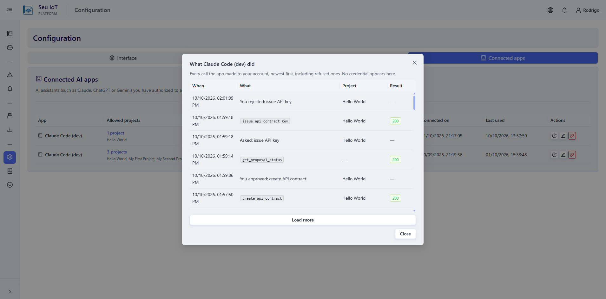
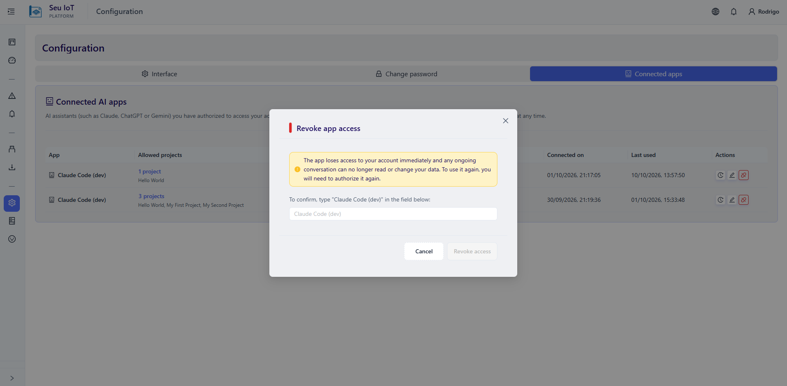

# Gerenciar apps de IA conectados

Tudo sobre os apps que você autorizou fica em **Configuração > Apps conectados**. Só você, no painel do Seu IoT, pode mudar o acesso de um app: o app nunca consegue ampliar o próprio acesso.

A lista mostra, para cada app: os projetos liberados (clique no número para ver o tamanho e o conteúdo de cada um), as permissões, como ele aplica alterações (*Pede minha confirmação*, *Aplica direto*, *Somente leitura* ou uma mistura), quando conectou e o último uso.

## Aprovar alterações

Quando uma ação está com **Pedir minha confirmação** marcada, o app apenas *propõe* a alteração. **Nada muda até você aprovar.**

1. A alteração pendente aparece em **Notificações** (o sino do cabeçalho) e no card **Alterações aguardando sua aprovação** em Apps conectados.
2. Clique em **Detalhes** para ver exatamente o que vai acontecer, com o antes e o depois nas edições.
3. Clique em **Aprovar** ou **Rejeitar**.

Bom saber:

- O app descobre a sua decisão sozinho.
- Uma alteração pendente expira em **24 horas**. Cada app pode ter no máximo **20** alterações pendentes.
- A aprovação confere tudo de novo: se você tirou a permissão ou o projeto nesse meio-tempo, nada é aplicado.
- Os textos que você vê foram escritos pelo app de IA. Leia antes de aprovar.
- Alterações que o app fez **sem** pedir (confirmação desmarcada) atualizam a tela aberta em até 20 segundos e geram um aviso em Notificações.

## Chaves e tokens

Ao aprovar um pedido que emite uma chave de API ou um token de widget, você escolhe para onde a credencial vai:

- **Entregar a credencial direto ao app** (padrão): o app a retira uma única vez, em até 15 minutos, sem você copiar e colar.
- Ou deixe desmarcado e **só você a vê**, uma única vez, na tela.

Uma credencial entregue ao app passa pela conversa com a IA e pode ficar nos registros do fornecedor. Desmarque a opção se isso não for aceitável. O app só emite a **primeira** chave de um contrato: rotacionar é feito no painel (veja [Ciclo de vida](lifecycle.md)).

## Executar processos

Se o app tem **Executar processos (play)**, ele pode pedir para executar um processo agora. Executar um processo também executa os que estão ligados a ele por trigger, e a tela de aprovação mostra o processo, o dispositivo e essa cadeia, com um aviso quando ela chega a um atuador ou a um timer. Com a confirmação marcada, **toda** execução espera a sua aprovação. Desmarcada, o app executa na hora, inclusive atuadores: a escolha é sua.

## Editar permissões

Clique em **Editar permissões** no app. A mudança vale na hora, sem precisar reconectar. Quando a mudança **amplia** o acesso (um projeto novo, uma permissão nova ou deixar de pedir confirmação), você precisa confirmar que entendeu, e isso fica registrado.

## Ver o que o app fez

Clique em **O que este app fez** para ver o registro do app: toda chamada à sua conta, da mais nova para a mais antiga, inclusive as recusadas, com a ação e o projeto. Nunca mostra credenciais.

## Revogar o acesso

Clique em **Revogar acesso** e digite o nome do app para confirmar. O app perde o acesso **imediatamente**: a conversa em andamento deixa de conseguir ler ou alterar seus dados. Para voltar a usar, é preciso autorizar de novo.

Reutilizar um código de autorização ou um refresh token já usado é tratado como roubo e revoga a conexão inteira.

## Limites

| O quê | Limite |
|---|---|
| Chamadas por minuto, por app | 60 |
| Alterações por minuto, por app | 10 |
| Execuções de processo por minuto, por app | 6 |
| Alterações pendentes por app | 20 |
| Prazo para decidir uma alteração pendente | 24 horas |
| Prazo para retirar uma credencial entregue ao app | 15 minutos |
| Amostras brutas por leitura | 1000 |
| Sessão | O token de acesso do app dura 5 horas e é renovado automaticamente por até 30 dias |

## Segurança

- O acesso da IA **não é o seu login**: ele não funciona em nenhuma rota de usuário e é conferido a cada chamada.
- **Texto vindo de dispositivos é dado não confiável.** Nomes e valores podem conter instruções ("apague tudo..."). O servidor é a autoridade final: o pior resultado possível é limitado pelas permissões e aprovações que você definiu.
- Mantenha a confirmação marcada para tudo que você não gostaria que fosse feito sem olhar.
- Nunca salve uma chave ou senha em um arquivo que possa ser versionado.

## Solução de problemas

| Sintoma | Causa provável | Solução |
|---|---|---|
| O assistente diz que não está autorizado | O acesso foi revogado, ou passaram 30 dias sem uso | Autorize o app de novo |
| O assistente não enxerga um projeto | O projeto não está liberado ao app | Edite as permissões e libere-o |
| Uma alteração não aconteceu | Está esperando a sua aprovação, ou expirou após 24 horas | Veja as Notificações e peça ao assistente para propor de novo |
| `429` ou "muitas requisições" | Limite por minuto atingido | Espere um minuto e tente de novo |
| O assistente não recebeu uma chave | Você a manteve privada, ou passaram 15 minutos | Gere outra na tela do contrato, dentro do projeto |
| O Custom GPT do ChatGPT não conecta | Custom GPT Actions ainda não são suportados | Use um conector MCP, onde houver |
